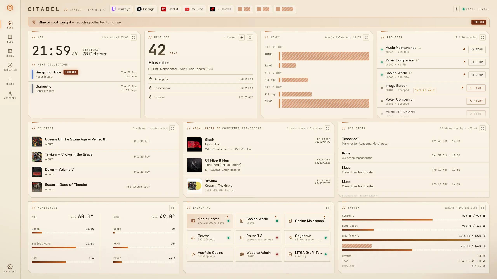
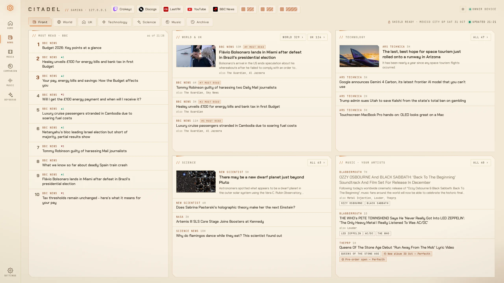
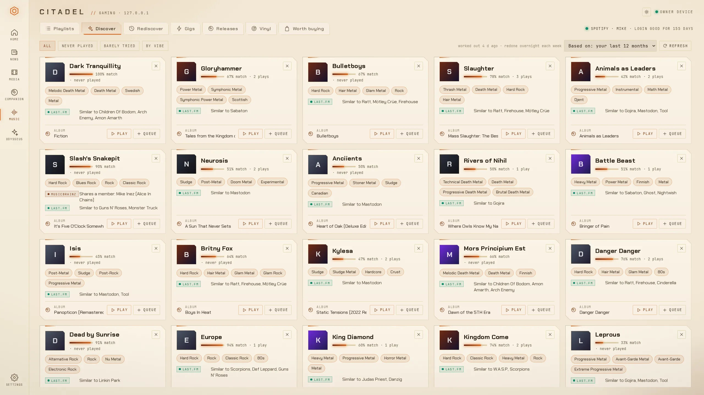
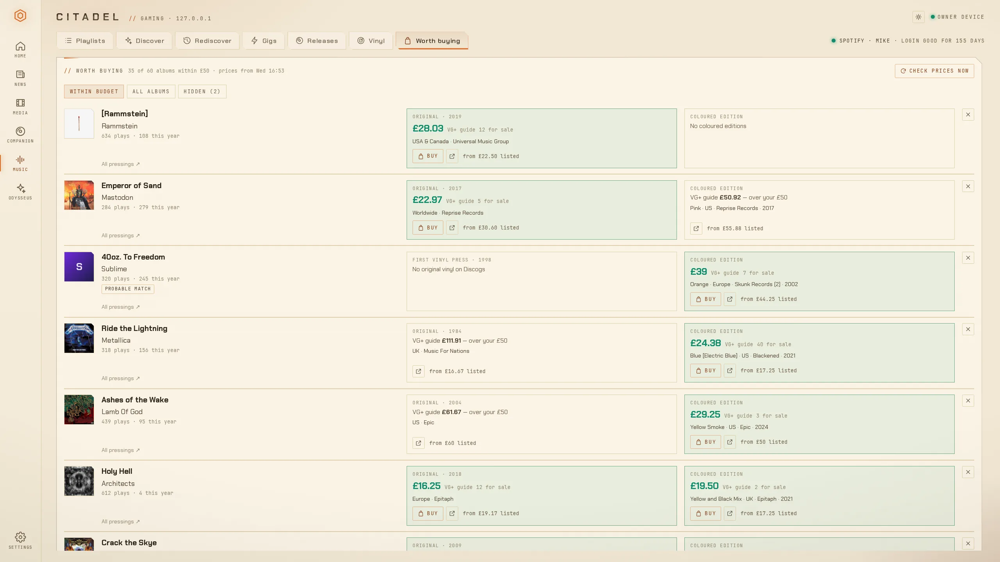
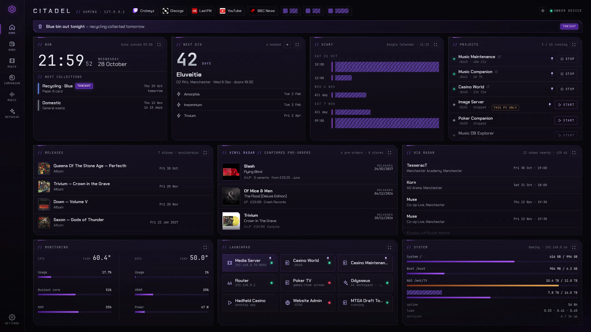

# Citadel

My home dashboard. It runs on my PC, any device on my home network can open it, and it keeps everything I'd otherwise forget about in one place.



## Background

I was sick of going to my council website every week to see which bins I needed to put out. Surely I could automate that? Then I bought a record I already had on pre-order. Relying on flagged emails just doesn't cut it in 2026.

It snowballed from there. It now does my news, builds my Spotify playlists, tells me which records are worth buying, starts and stops my other projects, monitors system resources, etc. 

There's a write-up with more screenshots on [my website](https://www.mikehadfield.co.uk/#/projects/citadel).

## What's in it

### Home

Every tile can be expanded into a full screen view with more detail, pinning and filters.

- **Bins** - which bin goes out tonight, pulled from the Council's website
- **Next gig** - a countdown to my next booked show
- **Diary** - my Google Calendar
- **Projects** - start and stop project services, with live uptime and logs
- **Releases** - upcoming albums from my top 200 artists, from MusicBrainz, up to a year ahead
- **Vinyl radar** - pre-orders from labels and record shops, with prices compared across stores. Anything I buy moves to a confirmed pre-orders list with a countdown to release day, so I never buy the same record twice again
- **Gig radar** - upcoming shows near me from Ticketmaster, for bands I actually listen to.
- **Monitoring** - CPU and GPU temperatures and usage
- **Launchpad** - quick links to everything on my network
- **System** - disk space for my PC and NAS, with a warning before anything fills up

### News



My own front page. BBC's Most read top 10 (with which stories are climbing), then World, UK, Technology, Science and Music sections.

- The same story from different outlets gets merged into one, so I'm not reading it five times
- The Music section only shows news about bands I listen to, linked to their upcoming releases, pre-orders and gigs
- Thumbs up/down on a story teaches it what I'm interested in
- Tabloids are blocked outright
- **F1 spoiler shield** - once a race weekend starts, nothing that could spoil it gets through until I've marked the race as watched

### Music



This hooks into my [Music Companion](https://mjhadfield.github.io/music-companion/) project (my record collection, around 100k Last.fm scrobbles and every gig I've been to).

- **Playlists** - designed from my own listening and saved to Spotify. Mix "ingredients" (deep cuts, a time capsule, a genre, a gig setlist, similar artists...) and set rules like how many songs per artist or how familiar it should be. Rotating playlists rebuild themselves on a schedule into the same Spotify playlist
- **Discover** - bands I've never (or barely) played, based on who I listen to most, also grouped by vibe
- **Rediscover** - bands I've drifted away from, with a one-click mix
- **Gigs** - a predicted setlist for each gig I've booked (from the band's last ten shows), and a pre-gig playlist that switches to the real setlist after the show
- **Worth buying** - albums I play a lot but don't own on vinyl, with the cheapest original pressing and coloured edition on Discogs right now
- A player bar that controls Spotify on whatever's playing



### Everything else

- **Media, Companion and Odysseus pages** - my Jellyfin media server, Music Companion and my local AI setup, embedded so they stay exactly where I left them when I switch pages
- **Guest page** - anyone else on the WiFi just gets the media server
- **TV mode** - pair a TV with a short code and it cycles through the panels I allow (with a slow pixel shift so nothing burns in). The diary is off by default, since guests can see the TV
- **Settings** - everything is editable in the browser: links, projects, news feeds, record shops, schedules, devices
- **Event log** - every sync, failure and error, with secrets stripped out before anything is saved
- **Nightly backups** and a health check that tells me when something's been failing
- **Light and dark mode**, plus custom themes with your own colours and background picture
- Works on my phone too

And yes, there's a dark mode:



## Being polite to other people's servers

Everything syncs overnight, once a day, one job after another, so no one gets hammered. If something fails it backs off and tries again later rather than retrying straight away. Record shops are read once a day, and the ones that ask for a delay between requests in their robots.txt get it.

I learnt this one the hard way with Spotify. It doesn't publish its rate limits, and an over-eager Discover rebuild earned me a 19-hour ban. Every Spotify call now goes through one pacer, and when Spotify says wait, it waits.

## How it works

Python ([FastAPI](https://fastapi.tiangolo.com/)) and plain HTML/JS with no build step. Everything I configure lives in one SQLite database.

It runs as a systemd user service on my PC. The projects it launches run as their own systemd units, so restarting Citadel doesn't kill anything.

There are no passwords. A device becomes an "owner" by opening a one-time link printed on the PC's terminal, which needs access to the PC itself. Everything else on the network only gets the guest page.

## Can I run it?

You can, but it's built around my setup. The bins only work for Salford, the Music page reads my Music Companion database, and the addresses of the embedded pages are hard-coded. You're welcome to have a look and borrow bits.

If you want to try it (Linux with systemd, Python 3.11+):

```bash
cp .env.example .env      # Jellyfin address, bin UPRN and calendar link (optional)
deploy/install.sh         # venv, dependencies, systemd service and the `hub` command
hub enrol                 # prints a one-time link to make your device an owner
```

Then open `http://<your-pc>:8080`. For development:

```bash
python3 -m venv .venv && .venv/bin/pip install -r requirements-dev.txt
.venv/bin/python -m pytest
.venv/bin/python -m app   # runs on :8080
```

## Credits

Data from [MusicBrainz](https://musicbrainz.org/), the [Cover Art Archive](https://coverartarchive.org/), [Last.fm](https://www.last.fm/), [Setlist.fm](https://www.setlist.fm/), [Discogs](https://www.discogs.com/), [Ticketmaster](https://developer.ticketmaster.com/), [Spotify](https://developer.spotify.com/), [Jolpica](https://github.com/jolpica/jolpica-f1) (F1 calendar) and the RSS feeds of the news sites it reads. The bins parser follows the approach of [UKBinCollectionData](https://github.com/robbrad/UKBinCollectionData). Not affiliated with or endorsed by any of them.

Fonts: [Chakra Petch](https://fonts.google.com/specimen/Chakra+Petch) and [JetBrains Mono](https://www.jetbrains.com/lp/mono/), both under the SIL Open Font License.
